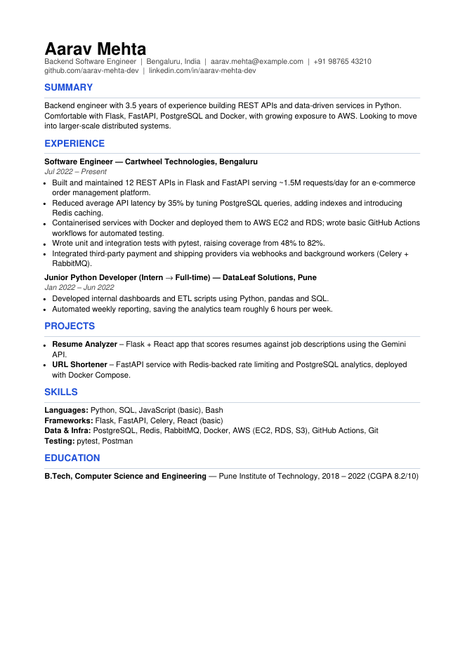
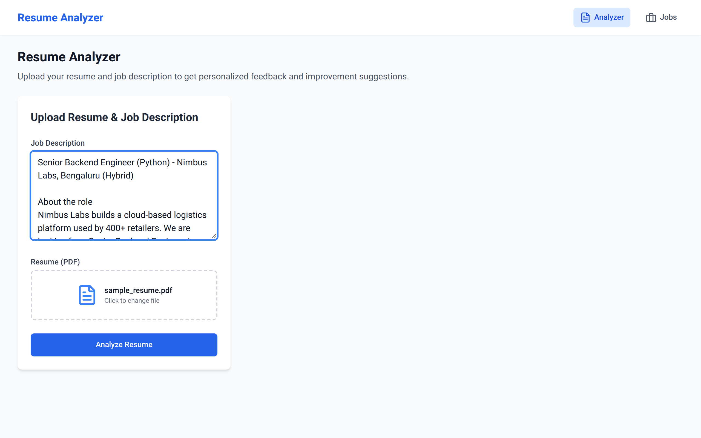
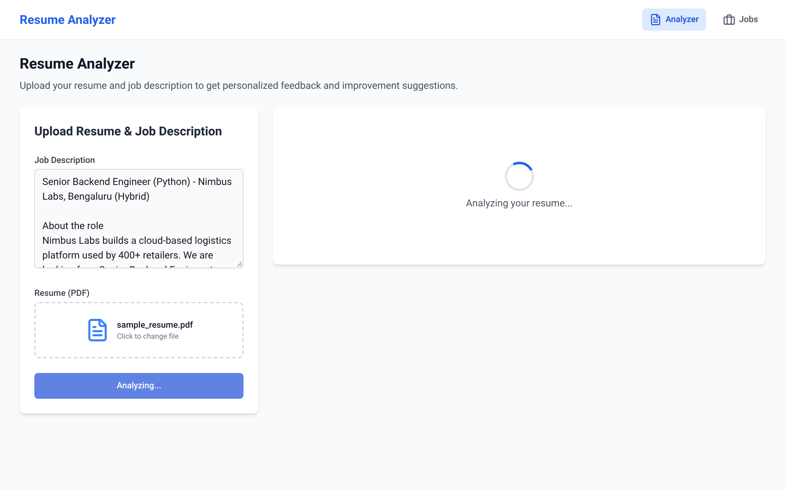
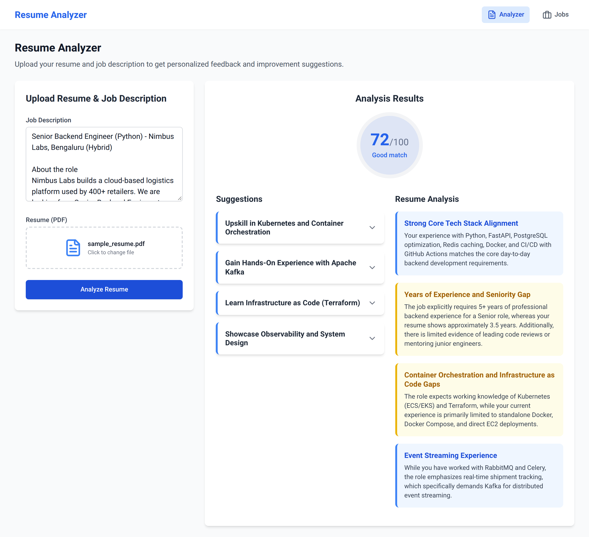
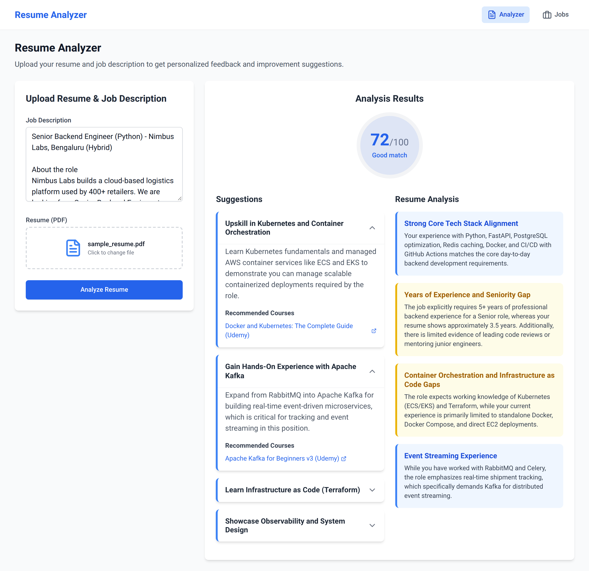
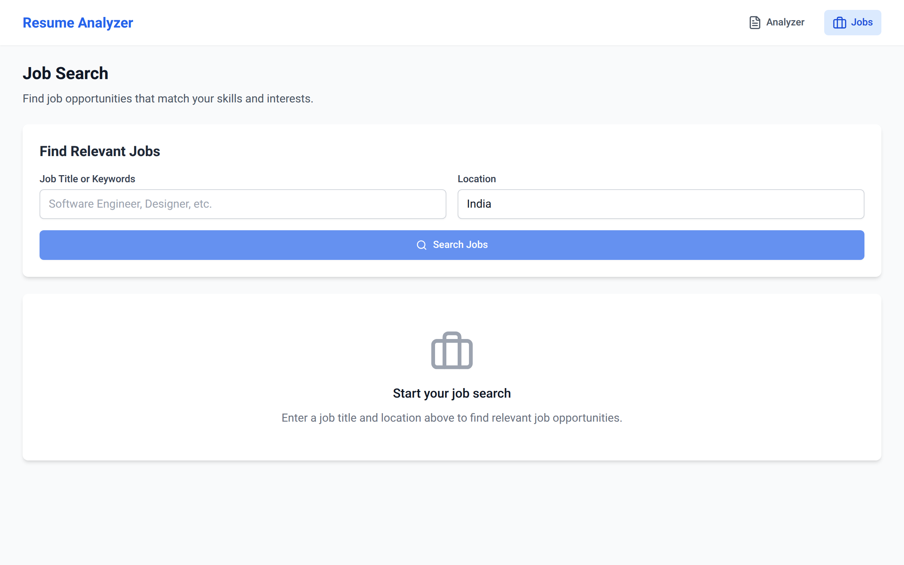
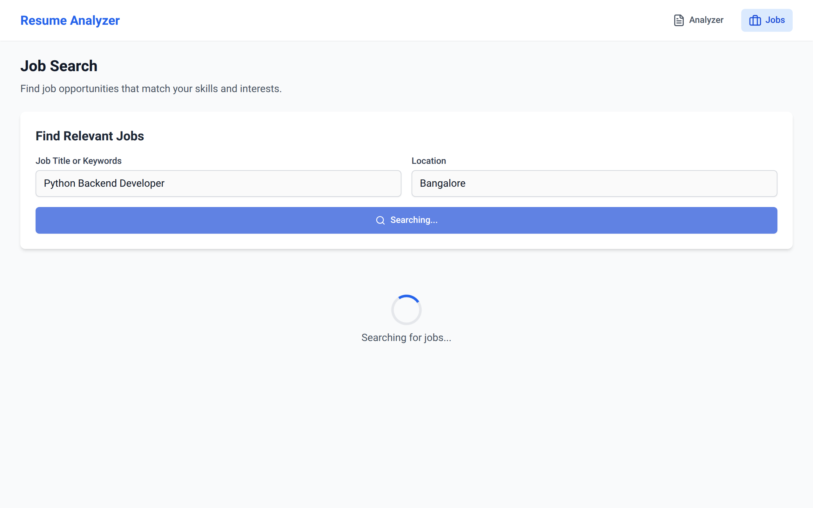
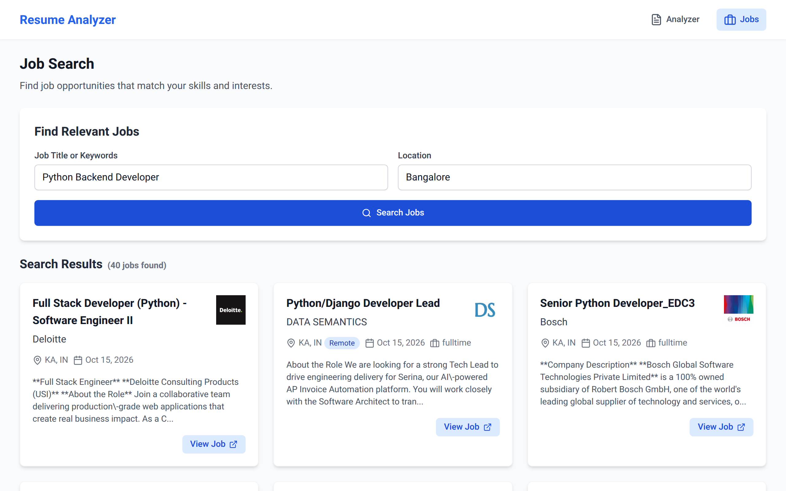
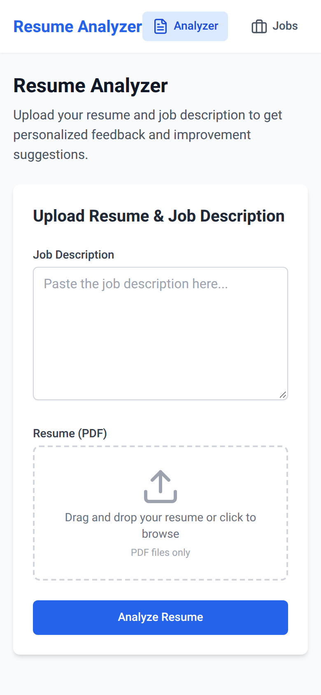

# Resume Analyzer & Job Search

A full-stack web app that scores your resume against a job description using Google Gemini, tells you how to improve it (with course recommendations), and lets you search live job listings from multiple job boards.

- **Backend:** Flask REST API (Gemini for analysis, [JobSpy](https://github.com/Bunsly/JobSpy) for job scraping, pypdf for PDF parsing)
- **Frontend:** React + TypeScript + Vite + Tailwind CSS

## Features

- **Resume scoring** – upload a PDF resume, paste a job description, get a 0–100 match score.
- **Reasoning** – strengths and gaps behind the score, colour-coded by severity.
- **Improvement suggestions** – 4–5 actionable suggestions, each with 1–2 recommended online courses.
- **Job search** – search by title and location across Indeed and LinkedIn (Naukri and Google are also attempted; see [Known limitations](#known-limitations)).
- Responsive layout that works on mobile.

## Screenshots

The screenshots below use the fictional resume and job description in [`samples/`](samples), so you can reproduce them yourself.

### Analyzer

| Sample resume (`samples/sample_resume.pdf`) | Upload form |
| :---: | :---: |
|  |  |

**Analysis in progress**



**Score, suggestions and reasoning**



**Suggestions expand to show recommended courses**



### Job search

| Search page | Searching |
| :---: | :---: |
|  |  |

**Results**



### Mobile



## Getting started

### Prerequisites

- Python (tested on 3.13) and [uv](https://docs.astral.sh/uv/) (or plain `pip`)
- Node.js 18+ and npm
- A Gemini API key from [Google AI Studio](https://aistudio.google.com/apikey)

### 1. Backend

```bash
# from the repo root
uv venv
uv pip install -r requirements.txt

# configure your API key
cp .env.example .env   # then edit .env
# or: echo "GEMINI=your_api_key_here" > .env

uv run python app.py   # or: .venv/bin/python app.py
```

The API starts on **http://127.0.0.1:3001**.

Without uv: `python -m venv .venv && source .venv/bin/activate && pip install -r requirements.txt && python app.py`.

### 2. Frontend

```bash
cd frontend
npm install
npm run dev
```

Open **http://localhost:5173**. The frontend talks to the API at `http://127.0.0.1:3001` (set in [`frontend/src/api/resumeApi.ts`](frontend/src/api/resumeApi.ts)).

### Configuration

Environment variables, read from `.env`:

| Variable | Required | Default | Description |
| --- | --- | --- | --- |
| `GEMINI` | yes | – | Your Gemini API key |
| `GEMINI_MODEL` | no | `gemini-flash-latest` | Gemini model used for analysis |

### Try it with the sample files

1. Go to the Analyzer page.
2. Paste the contents of [`samples/job_description.txt`](samples/job_description.txt) into **Job Description**.
3. Upload [`samples/sample_resume.pdf`](samples/sample_resume.pdf).
4. Click **Analyze Resume**.

Scores and suggestions come from an LLM, so they will differ slightly between runs.

## API reference

### `GET /api/health`

Health check.

```json
{ "status": "healthy", "service": "resume-analyzer-api" }
```

### `GET /api/schema`

Returns the JSON schema of the analysis result.

### `POST /get-score`

Analyzes a resume against a job description.

**Request** – `multipart/form-data`:

- `job` – job description text (required)
- `resume` – PDF file (required)

```bash
curl -X POST http://127.0.0.1:3001/get-score \
  -F job="$(cat samples/job_description.txt)" \
  -F resume=@samples/sample_resume.pdf
```

**Response**

```json
{
  "score": 72,
  "reasoning": [
    { "title": "Strong Core Tech Stack Alignment", "content": "...", "courses": [] }
  ],
  "suggestions": [
    {
      "title": "Upskill in Kubernetes and Container Orchestration",
      "content": "...",
      "courses": [{ "title": "Course name", "link": "https://..." }]
    }
  ]
}
```

**Errors** – `400` with `{"error": "No resume provided"}` or `{"error": "No job provided"}`; `500` with `{"error": "..."}` if the Gemini call or response parsing fails (for example when the Gemini API is temporarily overloaded; retrying usually works).

### `GET /search-jobs`

Searches job boards.

| Parameter | Required | Default | Description |
| --- | --- | --- | --- |
| `query` | yes | – | Job title or keywords |
| `location` | no | `India` | City, state or country |
| `results` | no | `20` | Results wanted per site |
| `hours` | no | `72` | Only jobs posted within this many hours |

```bash
curl "http://127.0.0.1:3001/search-jobs?query=python%20developer&location=Bangalore"
```

**Response** – an array of job objects. Fields include `title`, `company`, `location`, `date_posted` (epoch milliseconds), `job_url`, `site`, `description`, `job_type`, `is_remote`, `company_logo` and more.

**Errors** – `400` with `{"error": "Missing query parameter"}`; `500` with `{"error": "..."}` if scraping fails.

## Known limitations

- **Job sources:** Indeed and LinkedIn work. Naukri currently responds with a recaptcha challenge and Google Jobs returns no results, so those two usually contribute nothing.
- **Scraping:** job data is scraped by JobSpy. Check each site's terms of service before using this beyond personal use, and expect scrapers to break when sites change.
- **Dev server:** `app.py` runs Flask with `debug=True` for local development. Do not expose it publicly; use a production WSGI server (e.g. gunicorn) and disable debug mode when deploying.
- **PDF parsing:** only text-based PDFs are supported. Scanned (image-only) resumes have no extractable text.

## Tech stack

- [Flask](https://flask.palletsprojects.com/) and Flask-CORS
- [Google Gen AI SDK](https://github.com/googleapis/python-genai) (Gemini)
- [JobSpy](https://github.com/Bunsly/JobSpy) for job scraping
- [pypdf](https://pypdf.readthedocs.io/) and [Pydantic](https://docs.pydantic.dev/)
- [React](https://react.dev/), [TypeScript](https://www.typescriptlang.org/), [Vite](https://vitejs.dev/), [Tailwind CSS](https://tailwindcss.com/), [React Router](https://reactrouter.com/), [Lucide](https://lucide.dev/)

## License

This project is licensed under the [GNU General Public License v3.0](LICENSE).
